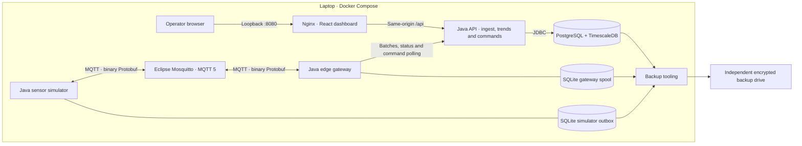
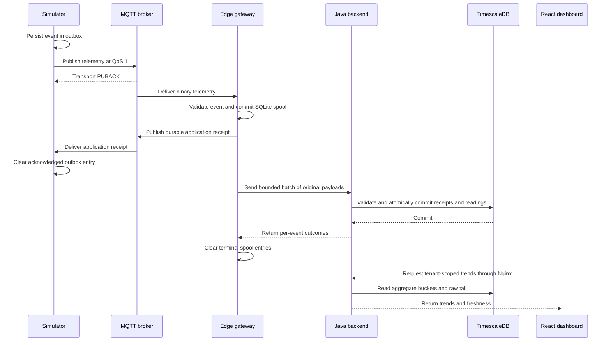

# Environmental IoT streaming platform architecture

**Version 0.2 · Baseline specification v0.3**

The platform is a single-laptop Docker Compose deployment. It runs six types of simulated sensors across at least two tenants, supports sampling controls from the browser, and is designed to ingest about 1 GB of unique telemetry bodies per active day over 15 days. Requirements and acceptance thresholds are defined in [specs.md](specs.md).

## 1. Deployment and service boundaries

Publish only the frontend port on loopback. Use private Compose networks to separate the browser proxy, sensor MQTT network, gateway/backend link and database. The gateway is the simulator’s ingress and command relay. The backend is the sole application service with database access. Backup tooling has a dedicated database role and writes to a mounted independent drive. Use separate named volumes for the database, spool and outbox. Give Compose services health checks and use readiness probes to verify dependencies. Startup and restart must tolerate dependencies coming up in any order.

## 2. Technology choices

| Area | Choice and rationale |
|---|---|
| Build | Temurin Java 25, Spring Boot 4.x and a Gradle Kotlin DSL multi-project build. Use a pinned Gradle wrapper. Reuse the Java toolchain and testing model from Invoice Intel. Put the backend, gateway and simulator in separate modules with independent images. |
| Backend | Spring MVC and Spring Security for APIs and operator sessions, HikariCP and PostgreSQL JDBC for explicit batch transactions, Flyway for schema migrations. Run migrations with a dedicated role and give application connections only the permissions they need. |
| Edge and simulation | Java services share versioned telemetry schemas and validation fixtures with the backend. Use Protobuf Java generated classes and shared, versioned per-type validators. Use Eclipse Paho MQTT v5 for simulator and gateway clients, and Eclipse Mosquitto for the local broker. Use SQLite on local volumes with WAL and `synchronous=FULL` for durable acknowledgments. Keep SQLite writes short and serialize writes within each service. |
| Transport | MQTT 5 over TCP with binary Protobuf for the sensor link. HTTP with bounded Protobuf batch bodies between gateway and backend. HTTP JSON for the browser API. The application outbox and spool own multi-day durability. |
| Database | PostgreSQL with the TimescaleDB extension for the reading hypertable and 15-minute continuous aggregate. Select and pin a compatible PostgreSQL/TimescaleDB image pair after checking native arm64 and amd64 support in M0. Keep retention and compression settings explicit and record changes in benchmark runs. |
| Frontend | React, TypeScript, Vite, Apache ECharts and TanStack Query for charting, query caching and polling. Nginx serves static assets and proxies API traffic. Use tenant-aware query keys and clear in-flight results when tenants switch. |
| Operations | Spring Boot Actuator and Micrometer for health and metrics. Capture local Prometheus metrics and Docker resource counters for the soak. Use PostgreSQL base backups plus WAL archiving and SQLite Online Backup API snapshots. |
| Verification | JUnit, ArchUnit, Testcontainers with the pinned Timescale image, Vitest and Playwright for the browser. Gatling measures the short CI workload. A separate local runner drives the calibration, pilot, soak and recovery profiles. |

Verify exact dependency and image versions in the first implementation PR and record them in the wrapper, dependency locks and Compose image references. [Spring Boot requirements](https://docs.spring.io/spring-boot/system-requirements.html) · [SQLite durability settings](https://www.sqlite.org/pragma.html#pragma_synchronous) · [PostgreSQL continuous archiving](https://www.postgresql.org/docs/current/continuous-archiving.html)

## 3. Telemetry data flow and idempotency

1. Each registered simulator stream emits a deterministic reading each second while enabled. A transaction persists the event and generator checkpoint before sending it. Persist a stable event ID and the original timestamp, version and value. Heartbeats use a separate path and continue while sampling is paused.
2. The broker authenticates the simulator and enforces topic ACLs. The gateway resolves tenant, device and sensor from the authorized topic and checks every event against the Protobuf contract and the registered sensor type’s validation rules. It publishes an application receipt after the SQLite spool commits. Duplicate MQTT deliveries use tenant/sensor/event identity and a content fingerprint at the spool while queued. The simulator keeps each event until acknowledged or permanently rejected.
3. The gateway sends up to 250 events per batch or flushes after one second. The Protobuf batch envelope carries each reading as original bytes plus gateway receipt metadata so each entry can be independently decoded and validated. It schedules tenants fairly and retries transport and transient database failures with bounded exponential backoff and jitter. The backend repeats authorization and schema validation and returns per-event outcomes for mixed batches.
4. Stage validated events for one database transaction per batch. Claim their tenant/sensor/event keys in the receipt ledger and insert readings only for newly claimed keys. The first committed version owns the key. Compare stored canonical content fingerprints for claims that already exist. Identical payloads return duplicate success and changed payloads return permanent conflict. Resolve duplicate IDs within a batch using the same rules. Write receipts and readings atomically and acknowledge after commit. A lost response replays the same IDs.
5. Remove terminal events from the spool only after the response is received and recorded. Keep reason-coded rejection and loss counters, with identifiers in diagnostic records and no raw payloads in logs. On queue saturation, return backpressure and preserve queued events.

Protobuf definitions and versioned validation rules live under `contracts/` and cover temperature, humidity, pressure, PM2.5, ambient light and oxygen concentration. Freeze canonicalization rules for each event version. Record original MQTT Protobuf payload sizes at the gateway and attribute unique accepted bytes to committed identities, separately from retry traffic and storage.

### MQTT topics and delivery

Use `iot/v1/{tenantId}/{deviceId}/{sensorId}/{kind}` with kinds `telemetry`, `heartbeat`, `receipt`, `command` and `command-ack`. Each device principal may publish telemetry, heartbeat and command acknowledgments for its assigned streams and subscribe to its receipts and commands. Gateway principals get only their assigned topic rights. Check topic IDs against registry assignments and payload IDs. Keep the broker on the private sensor network with anonymous access disabled. Provision locally from registry-derived ACLs and credentials kept outside Git.

Use QoS 1 for telemetry, application receipts, commands and command ACKs. Use QoS 0 for periodic heartbeats. Do not retain telemetry or commands. Use stable client IDs, bounded broker queues and reconnect with backoff and jitter. Session resumption can reduce retransmission, while the application outbox retries unchanged events whenever a durable receipt is missing. Apply broker packet limits before decoding. Correlate every accepted receipt with the immutable event ID and content fingerprint and every command ACK with the command ID and version. On full spool, issue retryable status correlated to the event and keep the simulator outbox entry. Bound retry concurrency per tenant. [MQTT 5 standard](https://docs.oasis-open.org/mqtt/mqtt/v5.0/mqtt-v5.0.html) · [Protobuf wire format](https://protobuf.dev/programming-guides/encoding/) · [Mosquitto configuration](https://www.mosquitto.org/man/mosquitto-conf-5.html)

## 4. Tenant-scoped data and analytics

### Registry schema

PostgreSQL is authoritative for tenant membership, provisioning and sensor metadata. Use UUIDs for identifiers, UTC timestamps for audit fields and explicit lifecycle states `active`, `disabled` and `retired`. A disabled registry identity cannot authenticate. An operator pause changes sampling state separately.

| Table | Primary key | Required columns and constraints |
|---|---|---|
| `tenants` | `tenant_id` | Unique slug, display name, lifecycle state, created timestamp |
| `operator_memberships` | `(tenant_id, operator_id)` | Foreign keys to tenant and operator, constrained role (`viewer` or `operator`) |
| `gateways` | `(tenant_id, gateway_id)` | Tenant FK, name, lifecycle state and credential reference |
| `devices` | `(tenant_id, device_id)` | Composite FK to assigned gateway, MQTT principal reference, unique broker client ID, label and lifecycle state |
| `sensor_types` | `type_code` | Canonical unit, description and default sampling period. Seed all six types. |
| `sensor_schema_versions` | `(type_code, schema_version)` | FK to type, Protobuf contract identifier, compiled validator revision, accepted value bounds and acceptance status |
| `sensors` | `(tenant_id, sensor_id)` | Composite FK to device, FK to type, display name, configured sampling period (default 1,000 ms) and lifecycle state |
| `sensor_state` | `(tenant_id, sensor_id)` | Composite FK to sensor, desired and confirmed enabled states, applied version, last heartbeat and last observation time |

Create the registry and seed type/schema metadata through Flyway. Use an idempotent local provisioning command to register demo tenants, gateways, simulated devices and sensors, then generate the broker ACL projection. Credentials are managed as secrets with registry references. A gateway starts with a validated registry snapshot and caches a versioned last-known-good copy on disk. It refreshes from the backend when reachable and accepts only provisioned identities during a partition. Backend revalidates current ownership and schema acceptance during replay. Keep prior schema versions accepted for the supported replay window unless revoked, and record any permanent rejection during reconciliation.

### Telemetry and control storage

| Relation | Key and role |
|---|---|
| `readings` | Time-partitioned hypertable with `(tenant_id, sensor_id, observed_at, event_id)` as the unique key and an index starting with tenant, sensor and descending observation time. Start with one-day chunks. |
| `event_receipts` | Relational ledger keyed by `(tenant_id, sensor_id, event_id)` with a canonical fingerprint. Include it in storage sizing and retain it for the full replay and raw retention windows. |
| `sensor_state`, `commands`, `command_outbox` | Tenant-scoped liveness, desired and applied states, command versions and delivery history. Store audit outcomes with tenant and actor. |
| `sensor_15m` | Private continuous aggregate grouped by tenant, sensor and UTC bucket. Store count, sum, min and max. |

Derive tenant context from authenticated service credentials or verified operator membership. Use transaction-local tenant context for row-level policies on supported relational tables and verify that a reused connection cannot inherit a prior tenant. Establish explicit tenant predicates for hypertable queries and private aggregate access. Keep aggregate relations inaccessible to end users. Scope command dispatch, caches, queue quotas and restore verification by tenant. Use integration fixtures with overlapping sensor and event IDs.

The trend path rolls 15-minute states into hourly, daily and Monday-aligned weekly UTC buckets using total sum divided by total count. Configure a materialized-only aggregate and query the raw tail where buckets have yet to be materialized. The aggregate reader uses a single verified materialization boundary aligned to a 15-minute edge, with a consistent database snapshot so the two ranges cannot overlap or leave a gap. Test this boundary against the selected TimescaleDB version before the soak. Refresh recent completed buckets every minute. Route older accepted readings to a durable repair queue keyed by affected time bucket and coalesce repairs. Expose freshness and render empty buckets as chart gaps. [Timescale continuous aggregate refresh](https://github.com/timescale/docs/blob/latest/use-timescale/continuous-aggregates/refresh-policies.md)

## 5. Sampling controls and status

The operator submits an authenticated, CSRF-protected enable or pause request. In one transaction the backend validates membership, records the desired state, allocates a monotonic per-sensor version and writes the command to its outbox. The gateway polls for unexpired commands and relays them to the simulator over MQTT. The simulator persists the applied version and sampling state before sending an ACK. The backend accepts an ACK only for its tenant, sensor and command version. A repeated idempotency key returns the prior command for an identical request and conflicts if the request changes.

The UI distinguishes requested state, last confirmed state and connectivity. An enabled stream with healthy heartbeats but no new readings for ten seconds shows stale. Three missed five-second heartbeats show offline. Use event time for freshness so old replay cannot make a stale stream appear live. Surface pending, failed, expired and superseded commands. Use an explicit restore generation when reconciling command versions after point-in-time recovery so restored state cannot replay stale instructions.

## 6. Multi-day recovery and scale measurement

- WAN loss leaves the Compose data path operational. A gateway/backend partition is absorbed by the gateway spool. Simulator/gateway isolation is absorbed by the simulator outbox. Size each queue to at least 10 decimal GB usable or 1.3 times measured seven-day on-disk growth, whichever is larger. Bound and monitor per-tenant allocation, total bytes, oldest-event age and disk headroom. Simulator downtime leaves a real gap for samples that were never generated.
- On reconnect, share ingestion capacity between live and replay traffic with fair tenant scheduling. Target total commits of at least 4× steady load, leaving at least 3× steady capacity for backlog if live traffic remains constant. The recovery test targets a seven-day backlog drained within three days. Verify while trends are under representative load.
- Take daily base backups and archive WAL continuously to the independent encrypted drive. Configure and monitor WAL segment archival lag, including during low throughput. Snapshot the two live SQLite databases with consistent backup tooling. Version a manifest with checksums, backup times, restore prerequisites and schema versions. Keep 30 days of recoverable backups through final verification. Measure backend RPO against the 15-minute target while archival is healthy and queue-volume RPO against the 24-hour snapshot target.
- Restore into isolated volumes with writes and dispatch paused. Recover PostgreSQL to the selected point using a matching PostgreSQL major and TimescaleDB extension version. Restore queue snapshots, invalidate older pending commands, reconcile simulator state and replay recoverable events through the normal receipt ledger. Independently taken backups can expose gaps, so reconcile saved counters and report unrecoverable ranges. Verify chart repair, tenant isolation and command behavior before reopening traffic. Measure queryable-stack recovery against four hours and backlog clearance separately.
- Before soaking, measure the receipt ledger, raw hypertable, indexes, aggregates, WAL, logging, both queues and independent backup usage. Report committed rates, rejects, retries and actual stored bytes, p95 ingest and trend timings, and CPU and RAM on days 1, 7 and 15. Use local dashboards and export CSV and Markdown. Recompute row count after measuring mean Protobuf payload size. At a mean of 90 bytes, the workload is approximately 129 readings/s and 167 million readings over 15 active days. Validate ledger growth and backup restore time early.

### Failure modes by pipeline stage

| Stage and failure | Detection | Recovery and verification |
|---|---|---|
| Simulator stops sampling, crashes or fills its outbox | Compare heartbeat and observation age; monitor disk and dropped samples | Mark stale or offline; resume from durable checkpoint, retry unsent messages, and reconcile genuine gaps. |
| MQTT broker unavailable, restarted, or gateway subscription lost | Track reconnects, session changes and unreceipted event age | Restore checked-in broker config and registry-derived ACLs; reconnect, resubscribe and replay producer outbox. Test recovery with empty broker session state. |
| Bad MQTT payload, topic mismatch or duplicate delivery | Count decode, validation, ACL and duplicate outcomes | Reject malformed or unauthorized frames. For a validly correlated duplicate, send the prior durable outcome or replay it safely. Record rejection by reason. |
| Gateway spool unavailable or saturated | Monitor spool commits, bytes, oldest-event age and receipt lag | Withhold acceptance until the spool is writable. Apply retryable backpressure, restart or restore the spool, and replay from both queues as needed. |
| Registry cannot refresh or credentials are revoked | Monitor snapshot age and auth failures | Admit known identities from the last verified snapshot during the partition. Keep new identities blocked until provisioned. Refresh ACLs and registry after reconnect and reconcile replay against backend authorization. |
| Gateway/backend partition, timeout or lost batch response | Track retries, oldest-event age and backlog drain rate | Keep accepted data in SQLite. After reconnect replay with original IDs, reconcile outcomes and drain fairly alongside live traffic. |
| Database down, commit ambiguous, disk full or volume corrupt | Track DB readiness, transaction errors, available space and WAL archive lag | Retry safely after capacity returns. For volume loss, restore base backup and WAL to fresh volumes and replay recoverable queues. Check receipt/reading consistency. |
| Aggregate refresh delayed or older events arrive | Track refresh lag and repair queue depth | Show freshness and missing data explicitly. Repair affected buckets and compare rollups with raw readings. |
| Command expires, ACK is lost, or a stale command arrives | Track ACK age, desired/reported state and command version | Retry while valid, apply each version once, reject stale or expired deliveries, and reconcile from the simulator’s stored applied version. |
| Dashboard or proxy loses API access | Show failed requests and timestamp of last successful refresh | Retry bounded reads, show stale data for that tenant only, and block control actions until connectivity and authorization are confirmed. |
| Backup drive offline or restore has missing WAL | Alert on backup age, archive gaps and checksum failures | Restore from the latest verifiable backup chain, replay available queues and report actual RPO and missing event ranges. |

## 7. Repository and implementation sequence

| Milestone | Architecture deliverable |
|---|---|
| M0 | Pin tooling and verify image architecture support. Establish module layout, Compose networks and volumes, and the Invoice Intel-style `CI gate`. |
| M1 | Add tenant identities and fixtures, telemetry schemas, deterministic simulator, SQLite queues, database migrations and idempotent ingest. Verify duplicate and isolation invariants before load testing. |
| M2 | Add continuous aggregates, tail queries, historical bucket repair and React trends. Measure all four resolutions under concurrent ingest. |
| M3 | Add acknowledged sensor controls, status monitoring, failure injection, backup automation and a restore drill. |
| M4 | Run calibration, 24-hour pilot and 15 active workload days. Record hardware, versions, configuration, interruptions and observed limits. |

Use `backend/`, `gateway/`, `simulator/`, `contracts/`, `frontend/`, `perf/` and `scripts/`. Keep migration ownership with the backend. Store repeatable Compose commands and failure drills in the runbook. Verify all spec acceptance IDs through tests or experiment evidence. Apply the documented protected-trunk and squash-merge policy once the GitHub Actions gate is verified. [Invoice Intel CI policy](https://github.com/utkarshmankad/invoice-intel/blob/c62b77ab8dccabffa43323ac5ef5dc7573e9a50f/docs/ci.md)
