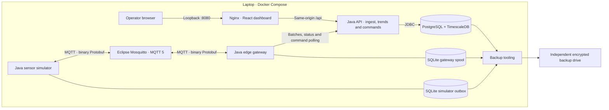
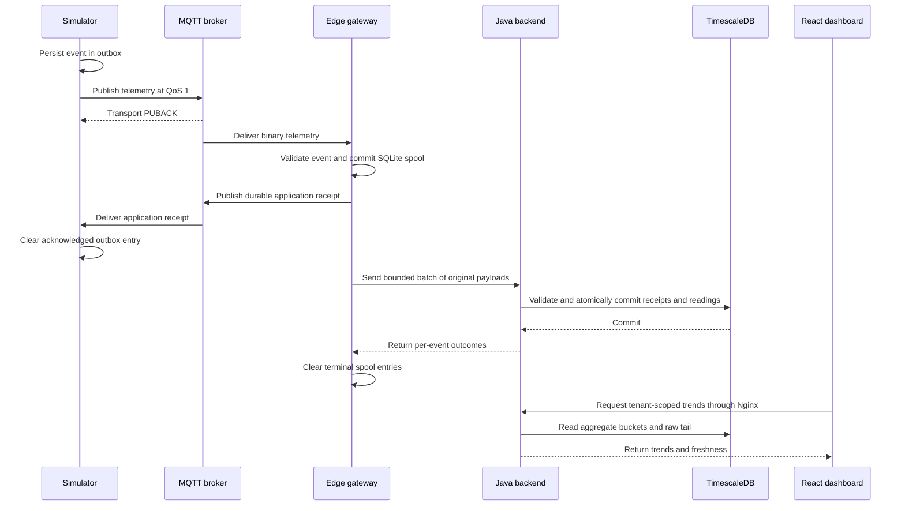

# Environmental IoT streaming platform architecture

**Version 0.6 · Specification v0.6**

The laptop Docker Compose deployment is the development, CI and soak baseline. The local two-host design below is for a physical ARM64 gateway. It runs six types of simulated sensors across at least two tenants, supports sampling controls from the browser, and is designed to ingest about 1 GB of unique telemetry bodies per active day over 15 days. Requirements and acceptance thresholds are defined in [specs.md](specs.md).

## 1. Deployment and service boundaries



Publish only the frontend port on loopback. Use private Compose networks to separate the browser proxy, sensor MQTT network, gateway/backend link and database. The gateway is the simulator’s ingress and command relay. The backend is the sole application service with database access. Backup tooling has a dedicated database role and writes to a mounted independent drive. Use separate named volumes for the database, spool and outbox. Give Compose services health checks and use readiness probes to verify dependencies. Startup and restart must tolerate dependencies coming up in any order.

For development, `compose.dev.yaml` provides TimescaleDB and an authenticated Mosquitto instance on configurable loopback ports. The Java services and Vite run on the host for debugging and hot reload. The development database has its own named volume. The deployment topology above keeps those dependency ports internal.

The deployment Compose file provides `local` and `test` profiles with distinct project names and storage. It builds separate images for backend, gateway, simulator and frontend, publishes only the dashboard on loopback, and isolates service links on internal Docker networks. A dedicated frontend ingress bridge has outbound masquerading disabled. M0 exposes Spring process readiness and metrics. Initial dependency readiness is checked by Compose before starting dependents. Runtime telemetry, dependency-specific readiness and the durable alarm receiver land with their feature tasks. [Local deployment runbook](docs/local-deployment.md)

### Local two-host Docker layout

~~~mermaid
flowchart LR
  subgraph Laptop["Laptop · local Docker"]
    Sim["Sensor simulator"]
    API["Java backend"]
    DB[("TimescaleDB")]
    Web["Nginx · React"]
    Monitor["Monitoring"]
    Web --> API
    API --> DB
  end
  subgraph ARM["One ARM64 Linux device · edge Docker"]
    MQTT["Mosquitto"]
    Gateway["Java gateway"]
    Card[("SD · spool and registry cache")]
    MQTT <-->|"MQTT 5 on private bridge"| Gateway
    Gateway --- Card
  end
  Sim <-->|"MQTT 5 on the site LAN"| MQTT
  Gateway <-->|"Authenticated registry, batches and command exchange"| API
~~~

| Host | Compose services and network access |
|---|---|
| ARM64 gateway | Run the Java gateway and Mosquitto as separate containers on one private bridge. The gateway resolves `mosquitto:1883` on that bridge. Bind the broker listener to the ARM device's site-LAN address for simulator traffic and limit access to the authorized sensor network. |
| Laptop | Run the simulator, Java backend, TimescaleDB, React/Nginx and monitoring. Use the broker's ARM LAN address for the simulator. Publish the dashboard on laptop loopback and provide a LAN listener restricted to the ARM device for the authenticated gateway endpoints. Keep TimescaleDB on the private laptop network. |

Provision the matching broker ACL and credentials from the laptop registry. Transfer the generated ACL to the edge securely and mount it read-only in Mosquitto. Store the MQTT data and the gateway state in separate directories. Mount the SD card by filesystem UUID, verify that it is present and writable before starting Compose, and bind its gateway state directory to `/var/lib/iot`. Keep SQLite WAL and `synchronous=FULL` with the spool and registry cache on that card. A missing or read-only card leaves ingestion unavailable until durable writes can resume. Measure the SD footprint separately from container images. The single-laptop Compose profile remains the reproducible CI and soak baseline.

### Future production and site recovery

Production places the Java backend, TimescaleDB and React monitoring in the cloud. Each site retains the ARM64 gateway, Mosquitto and the SD-backed queue. The gateway initiates authenticated connections to the cloud over the uplink.

| Scenario | Expected behavior |
|---|---|
| WAN link down while the gateway is running | The gateway continues writing to its SD card. The cloud dashboard shows stale data for that site. Replay starts automatically when connectivity returns. |
| Gateway down | The dashboard shows the site's last known data and reading time. A technician restores the gateway on-site. The restored gateway drains the surviving queue while forwarding new readings. |
| Backlog replay | Preserve original event IDs and observation times. Deduplicate retries and repair historical buckets where samples survive. Clear the stale indicator when fresh readings arrive. Unrecoverable readings remain gaps. |

## 2. Technology choices

| Area | Choice and rationale |
|---|---|
| Build | Temurin Java 25, Spring Boot 4.x and a Gradle Kotlin DSL multi-project build. Use a pinned Gradle wrapper. Reuse the Java toolchain and testing model from Invoice Intel. Put the backend, gateway and simulator in separate modules with independent images. |
| Backend | Spring MVC and Spring Security for APIs and operator sessions, HikariCP and PostgreSQL JDBC for explicit batch transactions, Flyway for schema migrations. Run migrations with a dedicated role and give application connections only the permissions they need. |
| Edge and simulation | Java services share versioned telemetry schemas and validation fixtures with the backend. Use Protobuf Java generated classes and shared, versioned per-type validators. Use Eclipse Paho MQTT v5 for simulator and gateway clients, and Eclipse Mosquitto for the local broker. Use SQLite on local volumes with WAL and `synchronous=FULL` for durable acknowledgments. Keep SQLite writes short and serialize writes within each service. |
| Transport | MQTT 5 over TCP with binary Protobuf for the sensor link. HTTP with bounded Protobuf batch bodies between gateway and backend. HTTP JSON for the browser API. The application outbox and spool own multi-day durability. |
| Database | PostgreSQL with the TimescaleDB extension for the reading hypertable and 15-minute continuous aggregate. Select and pin a compatible PostgreSQL/TimescaleDB image pair after checking native arm64 and amd64 support in M0. Keep retention and compression settings explicit and record changes in benchmark runs. |
| Frontend | React, TypeScript, Vite, Apache ECharts and TanStack Query for charting, query caching and polling. Nginx serves static assets and proxies API traffic. Use tenant-aware query keys and clear in-flight results when tenants switch. |
| Operations | Spring Boot Actuator and Micrometer for health and metrics. Capture local Prometheus metrics and host/container resource counters. Evaluate alert rules in Prometheus, route with Alertmanager, and store notifications in an independent SQLite alarm ledger. Use PostgreSQL base backups plus WAL archiving and SQLite Online Backup API snapshots. |
| Verification | JUnit, ArchUnit, Testcontainers with the pinned Timescale image, Vitest and Playwright for the browser. Gatling measures the short CI workload. A separate local runner drives the calibration, pilot, soak and recovery profiles. |

The M0.2 scaffold uses Temurin Java 25, Gradle 9.9.1, Spring Boot 4.1.2, Node 24.22.2, npm 11.19.1, React 19.3.1, TypeScript 7.0.2 and Vite 8.3.8. The wrapper and dependency locks capture the build dependencies. The Compose milestone uses `timescale/timescaledb:2.27.0-pg17` and `eclipse-mosquitto:2.0.22`, both available for Linux arm64 and amd64. [Spring Boot requirements](https://docs.spring.io/spring-boot/system-requirements.html) · [SQLite durability settings](https://www.sqlite.org/pragma.html#pragma_synchronous) · [PostgreSQL continuous archiving](https://www.postgresql.org/docs/current/continuous-archiving.html)

## 3. Telemetry data flow and idempotency



1. Each registered simulator stream emits a deterministic reading each second while enabled. A transaction persists the event and generator checkpoint before sending it. Persist a stable event ID and the original timestamp, version and value. Heartbeats use a separate path and continue while sampling is paused.
2. The broker authenticates the simulator and enforces topic ACLs. The gateway resolves tenant, device and sensor from the authorized topic and checks every event against the Protobuf contract and the registered sensor type’s validation rules. It publishes an application receipt after the SQLite spool commits. Duplicate MQTT deliveries use tenant/sensor/event identity and a content fingerprint at the spool while queued. The simulator keeps each event until acknowledged or permanently rejected.
3. The gateway sends up to 250 events per batch or flushes after one second. The Protobuf batch envelope carries each reading as original bytes plus gateway receipt metadata so each entry can be independently decoded and validated. It schedules tenants fairly and retries transport and transient database failures with bounded exponential backoff and jitter. The backend repeats authorization and schema validation and returns per-event outcomes for mixed batches.
4. Stage validated events for one database transaction per batch. Claim their tenant/sensor/event keys in the receipt ledger and insert readings only for newly claimed keys. The first committed version owns the key. Compare stored canonical content fingerprints for claims that already exist. Identical payloads return duplicate success and changed payloads return permanent conflict. Resolve duplicate IDs within a batch using the same rules. Write receipts and readings atomically and acknowledge after commit. A lost response replays the same IDs.
5. Remove terminal events from the spool only after the response is received and recorded. Keep reason-coded rejection and loss counters, with identifiers in diagnostic records and no raw payloads in logs. On queue saturation, return backpressure and preserve queued events.

Protobuf definitions and versioned validation rules live under `contracts/` and cover temperature, humidity, pressure, PM2.5, ambient light and oxygen concentration. Freeze canonicalization rules for each event version. Record original MQTT Protobuf payload sizes at the gateway and attribute unique accepted bytes to committed identities, separately from retry traffic and storage.

The simulator reads active demo assignments from a credential-free registry projection. It uses each device's registered broker client ID and separately provisioned credentials. A named volume holds the SQLite checkpoint and outbox. The generator preserves missed intervals as gaps during downtime and reports generated bytes, pending, accepted, rejected and capacity drops per tenant. The wire receipt carries the SHA-256 of the exact MQTT payload for correlation. The database receipt ledger uses its own canonical fingerprint for ingest idempotency.

The gateway keeps a separate MQTT session and one in-flight HTTP batch per tenant. It admits telemetry through the tenant’s latest verified registry topic and schema assignments. Original payload bytes, receipt time, the tenant’s byte budget, and acceptance counters are committed in one SQLite transaction before publishing an accepted receipt. The spool compares fingerprints for queued identities and records permanent outcomes by tenant, stage, and reason. It reserves batch slots for fresh readings and replay when both are eligible. Terminal outcomes release space. HTTP timeouts, invalid result lists, and transient responses leave rows available for bounded retry. The gateway can restart and resume admissions using a verified cached registry during a backend outage.

### MQTT topics and delivery

Use `iot/v1/{tenantId}/{deviceId}/{sensorId}/{kind}` with kinds `telemetry`, `heartbeat`, `receipt`, `command` and `command-ack`. Each device principal may publish telemetry, heartbeat and command acknowledgments for its assigned streams and subscribe to its receipts and commands. Gateway principals get only their assigned topic rights. Check topic IDs against registry assignments and payload IDs. Keep the broker on the private sensor network with anonymous access disabled. Provision locally from registry-derived ACLs and credentials kept outside Git.

Use QoS 1 for telemetry, application receipts, commands and command ACKs. Use QoS 0 for periodic heartbeats. Do not retain telemetry or commands. Use stable client IDs, bounded broker queues and reconnect with backoff and jitter. The simulator opens a fresh MQTT session on reconnect and resubscribes for receipts. The SQLite outbox retries unchanged events whenever a durable receipt is missing. Apply broker packet limits before decoding. Correlate every accepted receipt with the immutable event ID and content fingerprint and every command ACK with the command ID and version. On full spool, issue retryable status correlated to the event and keep the simulator outbox entry. Bound retry concurrency per tenant. [MQTT 5 standard](https://docs.oasis-open.org/mqtt/mqtt/v5.0/mqtt-v5.0.html) · [Protobuf wire format](https://protobuf.dev/programming-guides/encoding/) · [Mosquitto configuration](https://www.mosquitto.org/man/mosquitto-conf-5.html)

## 4. Tenant-scoped data and analytics

### Registry schema

PostgreSQL is authoritative for tenant membership, provisioning and sensor metadata. Use UUIDs for identifiers, UTC timestamps for audit fields and explicit lifecycle states `active`, `disabled` and `retired`. A disabled registry identity cannot authenticate. An operator pause changes sampling state separately.

| Table | Primary key | Required columns and constraints |
|---|---|---|
| `tenants` | `tenant_id` | Unique slug, display name, lifecycle state, created timestamp |
| `operator_memberships` | `(tenant_id, operator_id)` | Foreign keys to tenant and operator, constrained role (`viewer` or `operator`) |
| `gateways` | `(tenant_id, gateway_id)` | Tenant FK, name, lifecycle state and credential reference |
| `devices` | `(tenant_id, device_id)` | Composite FK to assigned gateway, MQTT principal reference, unique broker client ID, label and lifecycle state |
| `sensor_types` | `type_code` | Canonical unit, description and default sampling period. Seed all six types. |
| `sensor_schema_versions` | `(type_code, schema_version)` | FK to type, Protobuf contract identifier, compiled validator revision, accepted value bounds and acceptance status |
| `sensors` | `(tenant_id, sensor_id)` | Composite FK to device, FK to type, display name, configured sampling period (default 1,000 ms) and lifecycle state |
| `sensor_state` | `(tenant_id, sensor_id)` | Composite FK to sensor, desired and confirmed enabled states, applied version, last effective heartbeat and its source timestamp, and last observation time |

Create the registry and seed type/schema metadata through Flyway. Use an idempotent local provisioning command to register demo tenants, gateways, simulated devices and sensors, then generate the broker ACL projection. Credentials are managed as secrets with registry references. A gateway starts with a validated registry snapshot and caches a versioned last-known-good copy on disk. It refreshes from the backend when reachable and accepts only provisioned identities during a partition. Backend revalidates current ownership and schema acceptance during replay. Keep prior schema versions accepted for the supported replay window unless revoked, and record any permanent rejection during reconciliation.

The demo registry is provisioned by the one-shot Compose jobs. Flyway owns the schema through `iot_migrate`. The backend uses the restricted `iot_app` role with a transaction-local tenant setting. It reads the registry and claims receipts and writes readings in the telemetry schema. Gateway tokens are separate from MQTT passwords, generated outside Git, and stored in PostgreSQL only as SHA-256 digests. The two seeded tenants deliberately reuse registry IDs. The [overlapping event fixture](contracts/fixtures/overlapping-event-ids.json) supplies distinct synthetic values for later event isolation tests.

The registry endpoint authenticates gateway bearer tokens on the private gateway/backend network and returns the checked-in [registry Protobuf contract](contracts/proto/registry.proto). A strong ETag hashes the exact response bytes and changes when the authorized snapshot changes. The gateway checks the digest, format, assigned IDs and registry fields before replacing its cache. It invalidates cached access on an explicit authentication rejection.

### Telemetry and control storage

| Relation | Key and role |
|---|---|
| `telemetry.readings` | Time-partitioned hypertable with `(tenant_id, sensor_id, observed_at, event_id)` as the unique key and an index starting with tenant, sensor and descending observation time. Start with one-day chunks. |
| `telemetry.event_receipts` | Relational ledger keyed by `(tenant_id, sensor_id, event_id)` with a canonical fingerprint. Include it in storage sizing and retain it for the full replay and raw retention windows. |
| `sensor_state`, `commands` | Tenant-scoped liveness, desired and applied states, command versions and delivery history. Store audit outcomes with tenant and actor. Pending command rows form the indexed durable outbox. |
| `telemetry.sensor_15m` | Private continuous aggregate grouped by tenant, sensor and UTC bucket. Store count, sum, min and max. |

Derive tenant context from authenticated service credentials or verified operator membership. Use transaction-local tenant context for row-level policies on supported relational tables and verify that a reused connection cannot inherit a prior tenant. Establish explicit tenant predicates for hypertable queries and private aggregate access. Keep aggregate relations inaccessible to end users. Scope command dispatch, caches, queue quotas and restore verification by tenant. Use integration fixtures with overlapping sensor and event IDs.

Ingestion claims receipts in sensor and event UUID order under PostgreSQL Read Committed. After a competing claim resolves, a separate statement reads its committed fingerprint. The v1 fingerprint hashes big-endian schema version, sensor UUID, event UUID, observation milliseconds and finite IEEE 754 value with signed zero normalized. Wire encoding, unknown Protobuf fields and receipt timestamps do not affect event identity. Newly claimed readings reference the ledger row and preserve the original payload length, gateway receipt time and backend receipt time. Both inserts commit together before the HTTP response. [PostgreSQL Read Committed](https://www.postgresql.org/docs/17/transaction-iso.html#XACT-READ-COMMITTED)

Row-level security protects the receipt ledger. The backend can insert into the private hypertable, and its tenant comes from the gateway credential. The runtime role reads through a private SQL function that binds the authorized tenant before accessing either relation. The role has no direct raw or materialized read grant. TimescaleDB continuous aggregates require a source hypertable without row-level security policies. [TimescaleDB continuous aggregate requirements](https://www.tigerdata.com/docs/build/continuous-aggregates/create-a-continuous-aggregate)

The trend path rolls 15-minute states into hourly, daily and Monday-aligned weekly UTC buckets using total sum divided by total count. Configure a materialized-only aggregate and query the raw tail where buckets have yet to be materialized. The aggregate reader uses a single verified materialization boundary aligned to a 15-minute edge, with a consistent database snapshot so the two ranges cannot overlap or leave a gap. Test this boundary against the selected TimescaleDB version before the soak. Refresh recent completed buckets every minute. Route older accepted readings to a durable repair queue keyed by affected time bucket and coalesce repairs. Expose freshness and render empty buckets as chart gaps. [Timescale continuous aggregate refresh](https://github.com/timescale/docs/blob/latest/use-timescale/continuous-aggregates/refresh-policies.md)

The TimescaleDB jobs run once a minute as the migration owner. One refreshes the most recent 48 hours of completed UTC buckets and backfills older existing data in daily windows. It publishes the contiguous covered range only after the refresh succeeds. A single query snapshot reads materialized buckets inside that range and raw readings on either side. The other job repairs older arrivals from a durable, tenant-scoped queue. Ingest writes the repair marker with the reading, and a repair clears only the revisions it captured before refreshing. The reader reports the latest observation, refresh time, coverage edge, and pending repair for the requested tenant. The 30-day query window has no automatic raw-data deletion policy. [TimescaleDB job scheduling](https://www.tigerdata.com/docs/reference/timescaledb/jobs-automation/add_job) · [Continuous aggregate refresh](https://www.tigerdata.com/docs/reference/timescaledb/continuous-aggregates/refresh_continuous_aggregate)

## 5. Sampling controls and status

The operator submits an authenticated, CSRF-protected enable or pause request. In one transaction the backend validates membership, records the desired state, allocates a monotonic per-sensor version and writes the command to its outbox. The gateway polls for unexpired commands and relays them to the simulator over MQTT. The simulator persists the applied version and sampling state before sending an ACK. The backend accepts an ACK only for its tenant, sensor and command version. A repeated idempotency key returns the prior command for an identical request and conflicts if the request changes.

The simulator emits a heartbeat every five seconds, including while paused. The gateway validates it against the verified registry and forwards the newest observations in memory. It sends these independently of the durable telemetry queue so delayed samples cannot refresh connectivity. The backend scopes each observation to the authenticated gateway’s tenant and current assignments. It advances liveness only on a newer source timestamp, clips slightly future-dated observations to the receive time, and drops observations already 15 seconds old. Confirmed sampling state advances through the authenticated command acknowledgment path. The simulator can resend a persisted acknowledgment on reconnect.

The dashboard distinguishes requested state, last confirmed state and connectivity. An enabled stream with heartbeats and no new readings for ten seconds shows stale. Three missed five-second heartbeats show offline. Sample freshness uses event time so replay cannot make old readings appear live. The dashboard refreshes the visible registry every five seconds and polls a pending command every second. The registry includes the latest command outcome after reload. A temporary submission failure can be retried with the original idempotency key. Use an explicit restore generation when reconciling command versions after point-in-time recovery so restored state cannot replay stale instructions.

## 6. API specifications

This section implements ING-01 through ING-04, UI-01 through UI-03, CTL-01 through CTL-02, and TEN-01 through TEN-03 in [specs.md](specs.md). Check in the browser OpenAPI contract under `contracts/openapi/` and the internal Protobuf messages under `contracts/proto/`.

### Browser API

The React dashboard sends same-origin JSON requests through Nginx. Every request uses the authenticated session and its active tenant. A tenant switch must be authorized against the operator's memberships before it updates the session. Viewers can read registry and trends, and operators can also issue commands. Require a CSRF token for session mutations and commands. Use ISO 8601 UTC timestamps in responses, opaque string IDs and stable machine-readable status codes. The backend issues an HttpOnly, SameSite=Strict cookie scoped to `/api/v1`, with a 30-minute idle timeout. The client fetches a new CSRF token after login or a tenant switch. The local Compose script generates separate credentials for the seeded demo operators. Recheck membership on each registry or trend read. Sensor cursors bind to both the session and tenant. Return `Cache-Control: no-store` for authenticated responses.

| Method and path | Request | Success response |
|---|---|---|
| `GET /api/v1/session/csrf` | Guest or authenticated session cookie, if present. | `200` with `headerName` and `token`. Starts a guest session when needed. |
| `POST /api/v1/session` | CSRF token and JSON with `username`, `password` and optional `tenantId`. | `200` with the current memberships and `activeTenantId`. Rotates the session. |
| `GET /api/v1/session` | Authenticated session cookie. | `200` with the current memberships and `activeTenantId`. |
| `PUT /api/v1/session/tenant` | CSRF token and JSON with `tenantId`. | `200` with the authorized active tenant and current memberships. Rotates the session. |
| `DELETE /api/v1/session` | CSRF token and authenticated session cookie. | `204` and a cookie-expiration header. |
| `GET /api/v1/sensors` | Optional opaque `cursor` and `limit`, default 50 and maximum 200. Scope the cursor to the active tenant. | `200` with `items` and nullable `nextCursor`. Each item includes `sensorId`, `displayName`, `type`, `unit`, `samplingPeriodMs`, `desiredEnabled`, nullable `confirmedEnabled`, `connectivity` (`online\|offline\|unknown`), `sampleStatus` (`fresh\|stale\|paused\|unknown`), nullable `lastObservedAt` and `lastHeartbeatAt`, and nullable `latestCommand` with command ID, version, requested state and status. |
| `GET /api/v1/trends` | One to ten distinct repeated `sensorId` parameters, required `from`, `to`, and `bucket` (`15m\|1h\|1d\|1w`). The interval is `[from,to)`, with UTC-aligned boundaries, weeks starting Monday, and at most 30 days of retained history. Allow an aligned `to` at the end of the current bucket. | `200` with effective bounds, resolution, generation time, and `series`. Each series includes sensor ID, type, unit, and ordered buckets. Each bucket includes start, exclusive end, count, min, max, mean, and `partial`. Count zero yields null statistics. Include aggregate refresh timestamps and freshness state so the client can flag stale data. |
| `POST /api/v1/sensors/{id}/commands` | `Idempotency-Key` header and JSON body `{"enabled":false}` or `{"enabled":true}`. The dashboard supplies `X-IoT-Tenant` with its current tenant. | `202 Accepted` with `Location: /api/v1/commands/{commandId}` and a body containing `commandId`, `sensorId`, `version`, `requestedEnabled`, `status`, `createdAt` and `expiresAt`. A tenant header that disagrees with the active session returns `409 SESSION_CHANGED`. The dashboard polls the durable request before showing confirmation. |
| `GET /api/v1/commands/{id}` | Command ID from the create response. | `200` with command identity and requested state, `status` (`pending\|applied\|failed\|expired\|superseded`), nullable `confirmedEnabled`, nullable `resolvedAt` and optional `reasonCode`. An applied command requires a valid simulator acknowledgment. |

Example trend request for an aligned two-bucket window:

```http
GET /api/v1/trends?sensorId=8c2c6f50-5a22-4ab8-a3c9-0068e560aa01&from=2026-11-20T00:00:00Z&to=2026-11-20T00:30:00Z&bucket=15m
```

A returned bucket has the following shape. The enclosing series identifies the sensor and measurement unit.

```json
{
  "start": "2026-11-20T00:00:00Z",
  "end": "2026-11-20T00:15:00Z",
  "count": 900,
  "min": 20.1,
  "max": 22.3,
  "mean": 21.4,
  "partial": false
}
```

Scope command idempotency keys to tenant, actor and sensor. Store the normalized request and command reference with the command transaction. Identical replays return the same command ID and original acceptance response, even if its status has since advanced. Reusing a key with a different requested state returns `409 IDEMPOTENCY_CONFLICT`. The default expiration is 60 seconds from creation. If an acknowledgment arrives after the deadline, the command remains Expired. Record the valid late acknowledgment for audit. Update confirmed sensor state only when its device application timestamp is within the command validity window and its applied version is newer than the confirmed version. A sequence of commands can supersede pending requests. Status responses preserve the outcome for each command and cannot downgrade a newer confirmed sensor state.

Errors use `{"code":"INVALID_BUCKET","message":"…","requestId":"…"}` with optional field-level details. Use `400` for invalid parameters, `401` for a missing or expired session, `403` for insufficient permissions or CSRF failure, `404` for an unknown or out-of-tenant resource, `409` for conflicts, `429` with `Retry-After` for throttling, and `503` for temporary service unavailability. For a trend request containing an unknown or out-of-tenant sensor, reject the entire request with the same generic `404`. The dashboard polls visible trends about every 15 seconds and backs off on temporary errors. The backend defaults to 120 trend requests per tenant per minute. The read and session operations are defined in the [OpenAPI contract](contracts/openapi/browser-v1.yaml), including the M3.1 command operations.

The dashboard queries through TanStack Query and loads the Apache ECharts canvas when readings exist. Charts combine sensors that share a metric and unit, render missing buckets as gaps, shade partial buckets, and expose the underlying statistics in a keyboard-accessible table. The UTC range presets snap to aligned bounds and clip older partial buckets to the retained window. Normal polling runs every 15 seconds while the tab is visible. Transient errors slow polling and keep the same tenant’s last successful view. A tenant change cancels and clears tenant-scoped queries. Same-origin tabs coordinate cookie updates with a browser lock and notify each other to discard the old view.

The performance job starts 132 simulated one-hertz streams in two tenants. Five independent authenticated Gatling readers run three rounds of the 15-minute, hourly, daily and weekly API queries. A private metric records each newly accepted reading from gateway receipt through successful database commit. The runner samples the three-second histogram boundary before and after the scenario to check the ingestion p95 target under concurrent reads. The [CI runbook](docs/ci.md) lists the exact query mix and report paths.

### Internal gateway and backend API

The following paths are internal to the Compose network. Authenticate every call with scoped gateway credentials and derive the gateway and its authorized tenants from those credentials. Requests and responses use Protobuf over HTTP. Use UTC epoch milliseconds for internal timestamps.

| Method and path | Contract |
|---|---|
| `POST /internal/v1/telemetry/batches` | Batch of up to 250 entries and 1,100,000 serialized bytes. The Protobuf response is limited to 128,000 bytes. Each entry contains a unique correlation ID of up to 64 characters, authorized topic identity, original Protobuf telemetry bytes and gateway receipt timestamp. `200` returns one result per entry with `committed`, `duplicate` or `rejected` and a stable reason code for permanent rejection. Respond after the transaction commits. Use `400` for malformed batch envelopes, `413` for oversized batches, and `429` or `503` for transient failure. Retry timeout or transient outcomes with unchanged event IDs. Split an oversized batch and flag any individually oversized event. |
| `GET /internal/v1/registry` | Returns a versioned snapshot of gateway assignments, active device and sensor IDs, type and accepted schema versions. Supports conditional retrieval by snapshot version. Gateway persists the last verified snapshot. |
| `POST /internal/v1/sensor-heartbeats` | Gateway-scoped Protobuf batch of up to 250 observations and 64,000 bytes. Carries device and sensor identity, source time and last applied command version/state. Returns `204` after processing valid observations, `400` for malformed envelopes, `401` for failed authentication, `413` above limits and `503` for database unavailability. Old or out-of-scope observations are ignored. |
| `GET /internal/v1/commands/pending` | Returns a page of up to 100 unexpired commands for the authenticated gateway with tenant/device/sensor identity, command ID, version, requested state and absolute expiry. Polling does not complete delivery. Commands remain eligible for retry until their state advances or they expire. |
| `POST /internal/v1/commands/{id}/ack` | Reports command ID, sensor identity, version, actual state and device application timestamp. Duplicate valid ACKs are idempotent. Reject unauthorized or mismatched ACKs and prevent stale ACKs from overwriting newer state. |

The simulator uses the MQTT topic contract in §3. A telemetry receipt carries event ID, fingerprint, outcome and optional reason code. A command carries command ID, version, desired state and expiry. A command ACK carries the applied version and reported state. Keep MQTT payload contracts versioned alongside the HTTP batch and control messages.

### Contract verification

Run OpenAPI and Protobuf schema validation in CI. Exercise tenant-scoped pagination, all four bucket sizes and boundaries, empty and partial buckets, command creation and lookup, idempotency conflicts, and retry after lost responses. Ensure integration tests cover cross-tenant list, trends, commands, pending polling and ACKs, as well as partial success for mixed-validity telemetry batches.

## 7. Multi-day recovery and scale measurement

The [local recovery runbook](docs/recovery.md) describes the opt-in Compose archive overlay, mount identity, physical base backup and WAL checkpoints. The restore overlay uses fresh project volumes and serves the dashboard on a separate loopback port. It includes a private table of original queue IDs for receipt-ledger reconciliation and holds command issuance and dispatch until an explicit local resume. The restore records a UUID and a version floor above restored command and simulator versions. An isolated restore uses a fresh broker and discards cached Gateway acknowledgments.

- WAN loss leaves both local data paths operational while the site LAN remains available. A gateway/backend partition is absorbed by the gateway spool. Simulator/gateway isolation is absorbed by the simulator outbox. Size each queue to at least 10 decimal GB usable or 1.3 times measured seven-day on-disk growth, whichever is larger. Bound and monitor per-tenant allocation, total bytes, oldest-event age and disk headroom. Simulator downtime leaves a real gap for samples that were never generated.
- On reconnect, share ingestion capacity between live and replay traffic with fair tenant scheduling. Target total commits of at least 4× steady load, leaving at least 3× steady capacity for backlog if live traffic remains constant. The recovery test targets a seven-day backlog drained within three days. Verify while trends are under representative load.
- Take daily base backups and archive WAL continuously to the independent encrypted drive. Configure and monitor WAL segment archival lag, including during low throughput. Snapshot the two live SQLite databases with consistent backup tooling. Version a manifest with checksums, backup times, restore prerequisites and schema versions. Keep 30 days of recoverable backups through final verification. Measure backend RPO against the 15-minute target while archival is healthy and queue-volume RPO against the 24-hour snapshot target.
- Restore into isolated volumes with writes and dispatch paused. Recover PostgreSQL to the selected point using a matching PostgreSQL major and TimescaleDB extension version. Restore queue snapshots, invalidate older pending commands, reconcile simulator state and replay recoverable events through the normal receipt ledger. Independently taken backups can expose gaps, so reconcile saved counters and report unrecoverable ranges. Verify chart repair, tenant isolation and command behavior before reopening traffic. Measure queryable-stack recovery against four hours and backlog clearance separately.
- Before soaking, measure the receipt ledger, raw hypertable, indexes, aggregates, WAL, logging, both queues and independent backup usage. Report committed rates, rejects, retries and actual stored bytes, p95 ingest and trend timings, and CPU and RAM on days 1, 7 and 15. Use local dashboards and export CSV and Markdown. Recompute row count after measuring mean Protobuf payload size. At a mean of 90 bytes, the workload is approximately 129 readings/s and 167 million readings over 15 active days. Validate ledger growth and backup restore time early.

### Failure modes by pipeline stage

| Stage and failure | Detection | Recovery and verification |
|---|---|---|
| Simulator stops sampling, crashes or fills its outbox | Compare heartbeat and observation age; monitor disk and dropped samples | Mark stale or offline; resume from durable checkpoint, retry unsent messages, and reconcile genuine gaps. |
| MQTT broker unavailable, restarted, or gateway subscription lost | Track reconnects, session changes and unreceipted event age | Restore checked-in broker config and registry-derived ACLs; reconnect, resubscribe and replay producer outbox. Test recovery with empty broker session state. |
| Bad MQTT payload, topic mismatch or duplicate delivery | Count decode, validation, ACL and duplicate outcomes | Reject malformed or unauthorized frames. For a validly correlated duplicate, send the prior durable outcome or replay it safely. Record rejection by reason. |
| Gateway spool unavailable or saturated | Monitor spool commits, bytes, oldest-event age and receipt lag | Withhold acceptance until the spool is writable. Apply retryable backpressure, restart or restore the spool, and replay from both queues as needed. |
| Registry cannot refresh or credentials are revoked | Monitor snapshot age and auth failures | Admit known identities from the last verified snapshot during the partition. Keep new identities blocked until provisioned. Refresh ACLs and registry after reconnect and reconcile replay against backend authorization. |
| Gateway/backend partition, timeout or lost batch response | Track retries, oldest-event age and backlog drain rate | Keep accepted data in SQLite. After reconnect replay with original IDs, reconcile outcomes and drain fairly alongside live traffic. |
| Database down, commit ambiguous, disk full or volume corrupt | Track DB readiness, transaction errors, available space and WAL archive lag | Retry safely after capacity returns. For volume loss, restore base backup and WAL to fresh volumes and replay recoverable queues. Check receipt/reading consistency. |
| Aggregate refresh delayed or older events arrive | Track refresh lag and repair queue depth | Show freshness and missing data explicitly. Repair affected buckets and compare rollups with raw readings. |
| Command expires, ACK is lost, or a stale command arrives | Track ACK age, desired/reported state and command version | Retry while valid, apply each version once, reject stale or expired deliveries, and reconcile from the simulator’s stored applied version. |
| Dashboard or proxy loses API access | Show failed requests and timestamp of last successful refresh | Retry bounded reads, show stale data for that tenant only, and block control actions until connectivity and authorization are confirmed. |
| Backup drive offline or restore has missing WAL | Alert on backup age, archive gaps and checksum failures | Restore from the latest verifiable backup chain, replay available queues and report actual RPO and missing event ranges. |

## 8. Observability and alerting

Prometheus scrapes private metrics targets every 15 seconds and evaluates the rules in `observability/alerts.yml`. Spring Boot services expose Micrometer counters, gauges and latency histograms. Collect broker counters from Mosquitto's `$SYS` topics, database fleet totals through a restricted SQL function, and application timing through Actuator. The Docker operator's local sampler exports native host disk use, Docker resource usage and Nginx access timing. Keep the Prometheus data directory on a persistent volume with a 30-day retention setting and a size limit provisioned to hold that window based on the pilot. Report earlier eviction if the size limit is reached. Record UTC time and run ID in daily CSV exports so resource measurements can be aligned with incidents. [Prometheus alerting rules](https://prometheus.io/docs/prometheus/latest/configuration/alerting_rules/)

| Source | Signals |
|---|---|
| Simulator and MQTT broker | Expected and generated samples, paused/stale/offline counts, outbox usage, receipt age, reconnects, broker drops and client counts |
| Gateway | Accepted, invalid and duplicate events, spool occupancy, oldest queued event, retry rate, registry snapshot age and live/replay throughput |
| Java API and PostgreSQL | Unique committed rows and original payload bytes, rejects and conflicts, commit latency, database readiness, trend API latency/errors and aggregate freshness |
| Control plane | Command outcomes, pending age and time to simulator ACK |
| Containers, laptop and backup jobs | CPU, memory, restarts, storage headroom, WAL archive lag, verified snapshot age and backup target availability |

Use bounded labels such as service, stage, outcome, reason class and sensor type. Use tenant labels for the bounded soak fleet or derive per-tenant totals from tenant-scoped counters persisted outside the metric series. Keep event, command and sensor IDs in diagnostic records and the registry/status store. Correlate gateway and backend errors with event or batch IDs and commands with command IDs. Log counts and state transitions during steady operation instead of writing a success log for every sample.

### Initial alert policy

Every rule records severity, affected stage, first detection time, current measurement, threshold and runbook reference. These defaults are configurable and will be validated against the pilot.

| Signal | Threshold and severity | Local runbook action |
|---|---|---|
| Service or metrics target unavailable | Warning after 1 min; critical after 5 min for ingestion, database, or backup-path dependencies with sustained unavailability | Check container state and dependency health, then verify ingestion or backup activity resumed. |
| Enabled sensor stops reporting | Status is stale after 10 s or offline after three missed five-second heartbeats. Warn if an enabled sensor remains stale or offline for 1 min. | Look up last observation, heartbeat and command state. Check simulator and MQTT connectivity. |
| Queue usage or oldest event rises | Warning at 70% for 5 min or oldest event over 5 min; critical at 90% for 2 min, when a queue is full, or on any producer drops | Check failed hop, capacity and estimated time to fill. Restore the link, then watch replay drain and reconcile losses. |
| Ingest or trend latency degrades | Warning if ingest p95 exceeds 3 s or trend p95 exceeds 500 ms for 5 min with enough observations; critical for a complete ingest stall lasting 5 min with enabled producers | Inspect transaction and proxy errors, spool backlog and database performance. |
| Aggregate or control lag | Warning if scheduled refresh is over 5 min behind, or online command ACK p95 exceeds 5 s over a 5-min window with enough commands | Inspect refresh jobs or the command relay. Separate offline expiries from the online latency calculation. |
| Capacity or recovery protection at risk | Warning if projected soak headroom falls below 10 GB. Critical at 5 GB remaining, WAL archive age above 15 min while WAL is pending, a failed backup checksum, or a required daily backup over 26 h old. | Free safe capacity or reconnect the independent backup target. Verify a recoverable backup chain. |

Treat missing data as unknown or a scrape failure. Clear thresholds after their recovery condition is sustained for two evaluation intervals and use hysteresis for capacity signals. Suppress per-sensor notifications during a known broker or gateway outage while preserving sensor state in the dashboard. Record planned fault windows so the reports distinguish injected incidents and ordinary failures.

The database collector reads a fixed fleet summary every 15 seconds and returns unavailable or unknown on query failure. The SQL function returns counts and timestamps. It has no tenant arguments or raw telemetry access through the operation. Source timestamps and sample freshness use a bounded recent-reading lookup. Gateway queue utilization uses pending payload bytes divided by the per-tenant budget. Simulator receipt age measures time since the last terminal receipt while its outbox is nonempty. The collector publishes archive state and failure counters. The checked-in rules cover overdue verified backups, failed checksums and missing backup timestamps once the backup publisher is configured in M3.4.

### Log locations and operator access

| Record | Location and retention |
|---|---|
| Runtime and access logs | Service stdout/stderr, collected by Docker and accessible with `docker compose logs --since … <service>`. Use structured JSON where supported, UTC timestamps and service/component, severity, reason and correlation fields. Start with `json-file`, `max-size: 20m` and `max-file: 5` per service. Export relevant excerpts during incidents before rotation removes them. |
| Metrics and rule state | Prometheus persistent volume. Use the local Docker operator commands to inspect live rules and metrics. Export daily CSV summaries to `./run-artifacts/<run-id>/metrics/`. |
| Alarm notifications | Alertmanager groups duplicates and sends firing/resolved webhook notifications to a local receiver independent of the Java API and TimescaleDB. Persist them idempotently in `alarms.sqlite` on a dedicated volume before returning HTTP success. Key incidents by alert fingerprint and start time. Record severity, state, onset, receipt and resolution timestamps and the runbook link. Retain at least 30 days and export `./run-artifacts/<run-id>/alarms.ndjson`. |
| Commands and security audit | Tenant-scoped PostgreSQL audit tables record operator actions and command outcomes. Runtime logs record authentication failures with reason codes and minimal identifiers. Restrict audit reads to authorized users and omit credentials, cookies and raw telemetry. |
| Soak and recovery evidence | Local ignored directory `./run-artifacts/<run-id>/` contains summaries, alarm exports, incident logs and backup or restore drill reports. Track its storage usage in disk forecasts. |

Alertmanager sends firing and resolved notifications. It delivers an always-firing watchdog every 30 seconds. The receiver persists the last delivery, opens a monitoring gap after 90 seconds without a delivery and closes it on the next successful watchdog. The check runs on scrape and startup, so it records elapsed laptop sleep once the stack resumes. If the durable write fails, the receiver returns a retryable HTTP error so Alertmanager can retry delivery. Keep both the Prometheus and Alertmanager HTTP interfaces on private networks. Docker access is the platform-operator boundary for rule queries, grouped alerts, SQLite history and exports. The webhook requires its own generated bearer credential. The receiver has no HTTP history endpoint. Tenant operators see their sensor and command status in the product dashboard. A sleeping laptop cannot issue local alerts, so record the resulting gap after restart. Test the webhook and history during database downtime and check exports after container recreation. [Alertmanager](https://prometheus.io/docs/alerting/latest/alertmanager/) · [Docker log rotation](https://docs.docker.com/engine/logging/drivers/json-file/)

## 9. Fault injection test plan

Start each scenario from a known fixture on an isolated Compose project with disposable volumes and seeded tenants A and B. Use a fault profile with a controllable clock for command expiry and injectable transport cut points for lost receipts and ACKs. Use shortened alert windows for CI and separately test the production rule durations with Prometheus rule tests. During the pilot, run with production windows and record actual wall-clock detection and recovery times. Clear the fault and reset fixture state before the next scenario. Restrict fault injection controls to the test profile.

| Case and suite | Fault to inject | Expected behavior and recovery assertions |
|---|---|---|
| FT-01A · CI | Suppress readings for an enabled stream while continuing heartbeats, then stop its heartbeats | First stale, then offline after three missed heartbeats. Restart generation and verify the current status recovers and the chart retains a gap. Confirm a paused control stream does not raise the enabled-sensor warning. |
| FT-01B · CI | Restart the broker with empty session state, then stop and restart the gateway subscriber. In a separate run, suppress a gateway application receipt after the spool commits. | Simulator retains events after transport PUBACK, resumes publishing after reconnect, and retries original IDs after the gateway resubscribes. Gateway re-enqueues safely or returns the prior durable result. After drain there is one reading per unique valid event. |
| FT-01C · CI | Submit malformed Protobuf, missing fields, out-of-range oxygen, valid duplicate entries and a reused ID with changed content. Attempt a publish to the other tenant’s topic. | Broker rejects unauthorized publication. Gateway and backend reject malformed events at their own boundaries. Valid entries in a mixed batch commit, identical replay succeeds idempotently and modified content conflicts. Tenant B’s counts and results remain unchanged. |
| FT-01D · CI | Stop the backend or database service while the simulator runs, then drop a batch response after confirmed commit in a separate run. | Spool survives restart. Backend retries do not duplicate rows. During DB downtime the alarm receiver remains writable, and the outage and resolved notifications survive receiver recreation. |
| FT-01E · CI | Delay aggregate refresh and inject an older valid event within retention, including an event on a UTC bucket boundary. | Trends signal stale results. Repair the affected bucket and verify counts, weighted averages, bucket assignment and raw-tail boundaries against raw readings. |
| FT-01F · CI | Drop the ACK for an applied pause, inject an expired enable request and deliver an older version after a newer command. | Applied version survives simulator restart. A valid retry returns the existing result, expired or stale commands do not change sampling, and a replayed valid ACK reconciles state. Cross-tenant dispatch is denied. |
| FT-01G · Pilot | Cut WAN access while retaining Compose networking. Separately disconnect the gateway/backend link and exercise a seven-day-equivalent replay load as defined in AC-07. | Local ingest, trends and controls continue under WAN-only loss. A backend partition grows the gateway spool and triggers backlog alarms. Recover with per-tenant throttling. Measure elapsed time and verify the seven-day-equivalent backlog drains within the three-day target under live load. |
| FT-01H · Pilot | Bound tenant A’s spool allocation to a small test quota and flood it, then use a small disposable volume to exercise total-capacity alarms. | Tenant A receives backpressure. Tenant B retains its reserved capacity. Verify warning and critical escalation, intentional drops match counters, queued acknowledged events remain intact, and alarms resolve after drain. |
| FT-01I · Pilot | Disconnect the independent backup target or interrupt WAL archival; also test a checksum failure on a disposable copy. Restore to fresh volumes. | Alarm ledger records overdue or failed protection. Select the latest verifiable backup chain, restore database and queue snapshots, block old pending commands, and reconcile recovered data and tenant access. Record actual backend and queue RPO, queryable-stack restore time and backlog clearance separately. |
| FT-01J · Pilot | Stop the alarm receiver or interrupt scraping, then restart services. Record one laptop sleep/resume gap. | Watchdog reports the missed delivery or scrape gap when detection is available. Alarm history remains readable on restart. Monitoring records the sleep interval as unknown and resumes evaluation after wake. |

The short telemetry suite runs in a disposable Compose project using the fault overlay. It observes silence and MQTT heartbeats directly, recreates the broker with an empty session store and tests gateway and database/backend recovery. The explicit test profile can pause generation and withhold one durable application receipt per tenant. It records every generated identity in the simulator transaction and compares the final identity and timestamp sets with both TimescaleDB tables. It also submits valid and invalid binary fixtures for all six sensor types. The pinned backend integration test covers a lost HTTP response after commit. The Compose smoke test verifies online and offline status, confirmed pause and resume, and offline expiry across a simulator restart. The alarm smoke verifies rule timings, database-down ledger writes, resolution, duplicates, webhook access and a simulated monitoring gap. The longer fault drills follow in M3.5 and M4.

**Evidence.** Publish CI fault results and logs as test artifacts. Save pilot outputs under `./run-artifacts/<run-id>/fault-tests/<case-id>/` with the scenario manifest, assertion results, per-tenant counters, UTC timeline, alarm exports, logs and trend/control evidence. Label the injection window in the soak summary. Compare pre/post identity sets or event ranges on drain so discrepancies remain explainable even when counters reset. Fail a case if an expected alert, recovery invariant or tenant boundary is missing.

## 10. Repository and implementation sequence

| Milestone | Architecture deliverable |
|---|---|
| M0 | Pin tooling and verify image architecture support. Establish module layout, Compose networks and volumes, and the Invoice Intel-style `CI gate`. |
| M1 | Add tenant identities and fixtures, telemetry schemas, deterministic simulator, SQLite queues, database migrations and idempotent ingest. Verify duplicate and isolation invariants before load testing. |
| M2 | Add continuous aggregates, tail queries, historical bucket repair and React trends. Measure all four resolutions under concurrent ingest. |
| M3 | Add acknowledged sensor controls, observability rules, the alarm ledger, failure injection, backup automation and a restore drill. |
| M4 | Run calibration, 24-hour pilot and 15 active workload days. Record hardware, versions, configuration, interruptions and observed limits. |

Use `backend/`, `gateway/`, `simulator/`, `contracts/`, `frontend/`, `perf/` and `scripts/`. Keep migration ownership with the backend. Store repeatable Compose commands and failure drills in the runbook. Verify all spec acceptance IDs through tests or experiment evidence. Apply the documented protected-trunk and squash-merge policy once the GitHub Actions gate is verified. [Invoice Intel CI policy](https://github.com/utkarshmankad/invoice-intel/blob/c62b77ab8dccabffa43323ac5ef5dc7573e9a50f/docs/ci.md)

The 03:00 IST Nightly workflow includes a targeted PIT job alongside the image rescan. It publishes HTML and XML reports for critical ingress and control paths without adding a required PR status. The [CI guide](docs/ci.md) describes the selected scopes and artifact retention.

## Change history

Record changes to design decisions, interfaces or operational behavior here in the same pull request as the edit. Add one entry per change request with its date or version, a short summary, and the affected IDs or sections when applicable. Use a PR or commit reference when available. When a request changes more than one document, record its effect in each affected file.

| Baseline or change | Local commit | Design decisions recorded |
|---|---|---|
| v0.1 | `165ad55` | Established the Compose topology, technology choices, tenant-scoped storage, durable telemetry path, confirmed controls and multi-day recovery design. |
| v0.2 | `7810f2c` | Added Mosquitto, MQTT topics and binary contracts, the database registry schema, an end-to-end data flow, and failure and recovery behavior by stage. |
| v0.3 | `e30d4fb` | Defined Prometheus metrics and rules, Alertmanager routing, the independent SQLite alarm ledger, Docker log rotation and export locations. |
| v0.4 | `ddf4e48` | Detailed ten CI and pilot fault scenarios with injection steps, expected outcomes and evidence locations. |
| v0.5 | `af3a48d` | Defined browser API and internal gateway contracts, including authorization, errors, idempotency and contract verification. |
| Documentation tracking | This revision | Added a record of design changes and the convention for future entries. |
| M0.2 toolchain pins | This revision | Recorded exact scaffold dependency versions and selected PostgreSQL/TimescaleDB and Mosquitto images for the local and CI architectures. |
| M0.3 development environment | This revision | Added a loopback-only database and MQTT development profile, generated local credentials, and host-side build, test and debugging workflows. |
| M0.4 deployment scaffold | This revision | Added separate application images, private local/test Compose projects, health checks, monitoring scaffolds, persistent volumes and an offline recreation command. |
| M1.1 registry foundation | This revision | Implemented Flyway registry migrations, tenant-scoped reads, demo credentials and MQTT ACL projection, and an authenticated Protobuf snapshot with a verified gateway cache. |
| M1.2 simulator contracts and outbox | This revision | Added the versioned telemetry, heartbeat and receipt contracts, registry-derived simulation assignments, scoped SQLite checkpoint and retry behavior, and fresh MQTT sessions after broker restart. |
| M1.3 gateway spool | This revision | Specified the per-tenant MQTT admission and SQLite transaction, fair HTTP delivery, and batch wire limits and correlation. |
| M1.4 transactional backend ingest | This revision | Documented the one-day hypertable, receipt ledger, canonical v1 fingerprint, constrained runtime grants and correlated post-commit responses. |
| M1.5 telemetry fault suite | This revision | Recorded the isolated fault profile, test-only receipt and silence injection, per-identity reconciliation and protected CI evidence. |
| M2.1 analytics storage | This revision | Added the private 15-minute continuous aggregate, snapshot-consistent raw and materialized coverage, tenant-bound rollups, and a durable revisioned repair queue. |
| M2.2 browser read API | This revision | Added the OpenAPI contract, session and CSRF lifecycle, membership-bound tenant switching, sensor pagination and bounded trend queries. |
| M2.3 dashboard and performance | This revision | Added the tenant-scoped React dashboard, UTC chart and registry workflow, Chromium checks, and concurrent ingest and trend performance evidence. |
| v0.6 local ARM64, site recovery and command expiry | This revision | Designed co-located gateway and Mosquitto with an SD-backed spool. Recorded future cloud staleness, technician-led gateway recovery and the terminal Expired status for late acknowledgments. |
| M3.1 command relay | This revision | Added the tenant-scoped durable outbox, versioned MQTT command and acknowledgment relay, and persisted sampling state. Kept Expired terminal while auditing a valid late acknowledgment and reconciling newer confirmed state. |
| M3.2 control UI and liveness | This revision | Added scoped heartbeat ingestion, registry command summaries, and browser pause and resume controls with idempotent retries and visible expiry. Added Compose checks for recovery after an offline command and the online five-second p95 target. |
| M3.3 observability and alarms | This revision | Added scoped pipeline metrics and an authenticated local alarm receiver with an independent SQLite ledger. Recorded watchdog recovery, Docker operator access, daily export commands and verified alert rules. |
| M3.4 backup and recovery tooling | This revision | Added encrypted mount registration, verified physical backups and WAL checkpoints, SQLite online snapshots, isolated replay with a fresh control generation, and separate RPO and replay evidence. |
| FU-01 nightly mutation testing | This revision | Added scheduled PIT checks for ingress, schema validation, command timing, and durable queue and control state. Published per-module reports for 30 days. |
